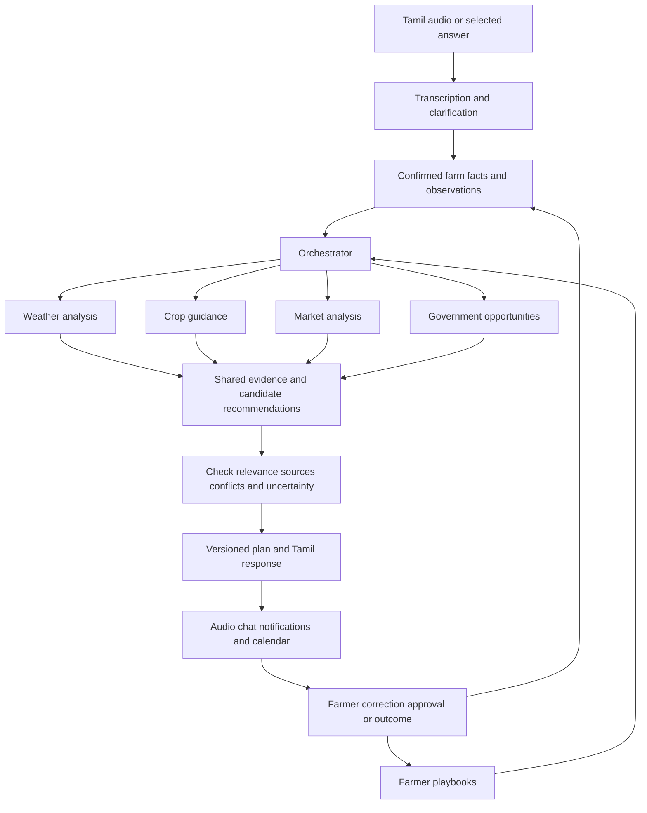

# Tamil farm assistant product and technical blueprint

Status: historical product blueprint, updated 17 November 2026 for the approved Pi Durable architecture. PRD.md and PRODUCT_SPECIFICATIONS.md are authoritative; implementation and acceptance evidence are recorded separately. Earlier web-app/PostgreSQL and FastAPI proposals are superseded.

Current product scope is governed by [PRD.md](PRD.md) and behaviour by [PRODUCT_SPECIFICATIONS.md](PRODUCT_SPECIFICATIONS.md). This earlier blueprint remains a research/design reference. Its React/web/database/provider suggestions are unselected options. The user has deferred UI refinement until the implementation-stack discussion; the storyboard is not an approved design.

## 1. Product and farmer journey

Build a Tamil-first farm assistant that combines a farmer's own observations with current weather, dated market information, agricultural guidance and verified government opportunities. Deliver practical weekly priorities, explanations and follow-up through replayable audio, short Tamil messages and context-sensitive choices. The farmer can complete onboarding independently, with optional help from a friend or neighbour.

The central product hypothesis is that farmers need help deciding what deserves attention next under changing conditions and limited resources. Validate this with farmers; source availability alone does not establish the pain point or prove increased profit.

### Agreed first-phase boundaries

- Tamil is the first farmer-facing language. Prepare locale resources for expansion, but do not claim additional languages are supported until tested.
- In-app recorded audio messages and replies, text alternatives, replay and selectable responses are the primary interaction. WhatsApp calls belong to a later phase.
- Weekly work planning and harvest/selling support are connected features, not separate assistants.
- Include farmer-specific playbooks, relevant government benefits, seasonal learning and notification/calendar guidance.
- Give evidence-based guidance and dated market trends first, including externally supplied weather forecasts. Building our own price/yield forecasting remains deferred until historical evaluation supports its use.
- Approval records the farmer's agreement to a proposed task. It does not operate equipment, purchase inputs, submit applications or prove completion.

### First use

1. Present Tamil in its own script with a listenable preview. Explain that the service is automated and that recordings are processed to provide assistance. Offer help without making it mandatory.
2. Start a short conversation by asking the farmer's immediate concern. Collect relevant details from village or location, crop, sowing/transplanting date or approximate stage, known soil information and irrigated/rain-fed status. Provide spoken choices, typed replies and “I don't know.” Ask about one field/crop at a time; allow additional fields later. Do not require soil details to answer a market question.
3. Record using tap to start, tap to stop, preview, discard or send. Retain unsent recordings locally until sent or discarded. If microphone access is denied, continue with text and choices.
4. Read back consequential facts, including crop, location, dates, area and units. Ambiguity creates a clarification request, not a guessed profile update. Confirm whether a supplied date is sowing or transplanting.
5. Continue from the selected concern and ask what work is pending when relevant. Collect water, labour, symptoms or selling constraints only when needed for that decision.
6. Ask for update preferences and notification permission after explaining their value. Use Asia/Kolkata for local dates and schedules. Offer morning/evening choices; permit editing or disabling them later.
7. Give the first useful information after village and crop are confirmed, before completing the entire profile. Return an initial weekly plan where evidence is sufficient, or useful observations/priorities plus precise unanswered questions. Field-specific advice still waits for its required facts. Do not withhold all useful information because one source is unavailable.

Each assistant message has audio, matching Tamil text, replay and relevant choices. Keep explanations in short segments. Do not autoplay speech from background notifications. Display the conversational record on return and resume onboarding from the last confirmed answer.

### Everyday use

Use three simple destinations: Today, My Week and My Farm. Today is the normal return destination: latest relevant audio guidance, its dates, a prominent listen action and a reply control. It links to the full conversation containing voice messages, guidance, market comparisons and opportunities. My Week combines proposed/approved tasks, reminders and deadlines. My Farm exposes confirmed details, notification/language preferences and saved playbooks. Notifications open their exact relevant item. If no new guidance exists, say so; do not present an expired advisory as current.

Contextual choices include explain why, correct this, repeat, approve, already done, postpone and get help. Speak choices on request. Reading or listening never counts as approval. A helper may assist navigation, but their involvement must not silently replace the farmer's contact details or decisions.

## 2. Reasoning and cooperating agents

### Shared evidence and execution flow

The orchestrator uses Claude for conversational reasoning and tool selection, with explicit application controls for profile confirmation, source validity, approval and scheduling. Speech recognition and speech synthesis are separate services. Keep provider credentials on the server. One provider key is not sufficient for the entire system.

| Responsibility | Inputs | Expected output |
| --- | --- | --- |
| Weather analysis | Confirmed location, forecast and available recent observations | Dated weather conditions relevant to planned tasks; limitations and questions |
| Crop guidance | Crop, confirmed/estimated stage, symptoms, field observations and retrieved agricultural guidance | Applicable guidance, missing facts and expert-help cases; no invented diagnosis or chemical doses |
| Market analysis | Crop/commodity match, market observations, feasible markets, harvest readiness, quantity, grade and supplied costs | Dated comparisons and transparent arithmetic when inputs suffice; no promised selling price |
| Government opportunities | Farmer-confirmed relevant facts, current official scheme documents and application routes | Potential matches, known/unknown eligibility conditions, verified deadlines and next steps |
| Orchestration | Agent results, source status, farmer constraints and applicable playbooks | Reconciled weekly plan or targeted questions, explanation and traceable agent log |

Agents share structured evidence rather than copying unrestricted conversation histories. Each result includes supporting source records, observation/effective dates, applicability, missing inputs and limitations. External content is evidence, never authority to change system rules or approve actions.

Delegate only relevant work. A language preference change does not require fetching all sources again; a corrected location invalidates location-dependent reasoning. Reuse compatible source snapshots across farms without sharing private farm information. Cache on source/geography/commodity/time range and honour freshness rules. Replaying saved audio must not rerun reasoning or regenerate the message.

### Current data and inference

- Preserve original source date separately from retrieval time. A successful fetch today does not make an old observation current.
- Weather supports conditional guidance. Modelled soil moisture is not a sensor reading from the farmer's field; reference evapotranspiration alone is not an irrigation prescription.
- Prefer applicable dated local advisories for crop actions. Do not derive agronomic thresholds or interventions from the language model alone. Preserve conflicting evidence and ask for clarification or expert review when the conflict affects safety or relevance.
- Market comparisons retain commodity/variety where available, market, units, observation date and aggregation period. Missing observations are missing, not zero. Use farmer-supplied reachable markets rather than assume geographical proximity means access.
- Compare estimated proceeds only with stated quantity, comparable price observations and explicitly supplied/labelled costs. Do not present the result as a binding quote or profit guarantee.
- Short-term weather changes inform this week's operations. Long-term climate adaptation needs appropriate historical and local contingency guidance; do not infer climate change from one forecast.
- Forecasting is a later evidence gate: define target, horizon and coverage; use time-ordered evaluation without future leakage, compare with simple baselines, measure error/interval coverage and withhold predictions for unsupported crops or markets. No generated numerical confidence scores in place of evaluation.

### Farmer memory and playbooks

Store three distinct kinds of knowledge: confirmed farm facts/preferences, dated farmer-reported actions/outcomes, and reusable candidate playbooks. Retain whether information was reported, inferred or professionally reviewed. A reported improvement after an action is an observation, not proof that the action caused it.

Each playbook describes its crop/field/season context, purpose, prerequisites, source-backed steps, evidence, reported outcomes, review status and last review date. Reuse requires checking current crop stage, available resources, weather and source applicability. A changed context can suspend or retire a playbook. Corrections propagate to dependent plans and memories; preserve history rather than silently overwrite it.

Candidate playbooks may be saved from farmer-reported completed activity history, but become reusable only after named review and current source/context checks pass. Versioned improvement proposals require passing labelled held-out farm and Tamil comprehension evaluations before candidate release approval; production prompts/tools/rules never rewrite themselves automatically. Farmer confirmation establishes their reported facts and preferences; it does not certify an agricultural intervention as correct. Advice requiring professional validation remains pending that review even if a farmer reports a good outcome.

Example: remember that a farmer prefers a particular reachable market, has transport on certain days and uses a confirmed harvest-preparation checklist. Reuse those facts next time, while refreshing market observations and asking whether transport is still available. Do not turn a single successful season into a universal agricultural recipe.

Personalisation initially means retrieval, better questions, source reuse and feedback—not automatic model retraining. Cross-farmer learning is outside v1; a private anecdote must not become another farmer's recommendation.

### Agricultural mapping and farmer learning

Maintain a field-specific evidence map using the existing records: location and applicable agricultural region, soil information, crop/variety, crop cycle and stage, water access, observed conditions, relevant guidance, planned work and accessible markets. Each relationship retains its source and uncertainty. This is a way to connect records, not a requirement for a separate graph database.

- Match local crop names to a commodity or crop-guide identity only after confirmation where ambiguous. Preserve the original Tamil name so agents do not lose the farmer's terminology.
- Treat village/district location as a route to relevant evidence. Do not infer a particular field's soil or water access from a district average. Record farmer-reported soil separately from any mapped estimate or soil-test result.
- Estimate crop stage from a confirmed sowing/transplanting date and applicable guidance, then ask for confirmation before stage-dependent work. Actual observations can correct the estimate.
- Combine the map with current source records to identify relevant guidance. Missing links become focused questions; they must not be filled with invented crop coefficients, irrigation quantities or benefit eligibility.
- For selling, connect the crop cycle to farmer-confirmed harvest readiness, quantity, available storage, transport and reachable markets. Mark unverified commodity/grade comparisons as unsuitable rather than silently equate them.

Every important advisory offers a short “why this matters” audio explanation: what changed, how it relates to this crop/field, what the farmer can check, and what remains uncertain. Optional learning messages explain a term or market comparison in context; they do not create a compulsory course or an additional onboarding burden.

For weather adaptation, explain immediate conditions using current forecasts and applicable advisories. For next-season planning, retrieve relevant local contingency and historical material, explain options and tradeoffs, and invite the farmer to discuss changes with an appropriate expert where needed. A climate trend, expected yield or financial gain must not be invented to make a lesson persuasive.

Close the learning loop with one relevant follow-up after a task: completed, postponed, could not do, or observed outcome. Record the farmer's account and ask whether a useful explanation should be saved with the playbook. Future messages can use confirmed vocabulary and preferences while refreshing the evidence. “Smarter over time” means demonstrably fewer repeated questions and more relevant retrieval, not an assumed improvement in agronomic correctness.

## 3. Sources and government opportunities

| Source | Planned role | Qualification |
| --- | --- | --- |
| [Open-Meteo documentation](https://open-meteo.com/en/docs) | Forecast weather, precipitation probability, wind, modelled moisture and reference evapotranspiration | Verify actual endpoint responses, units, location and timestamps during integration |
| [CEDA data portal](https://ceda.ashoka.edu.in/data-portal/) and [API documentation](https://api.ceda.ashoka.edu.in/documentation/) | Dated commodity prices/arrivals and trends | Portal describes monthly updates; verify each returned series rather than label it live. [Published terms](https://ceda.ashoka.edu.in/api-terms-conditions/) specify non-commercial use and attribution |
| [KCC supplied portal](https://kcc-chakshu.icar.gov.in/) and [government catalogue](https://data.gov.in/catalog/district-wise-and-month-wise-queries-farmers-kisan-call-centre-kcc) | Contextual retrieval of past farmer questions/answers | Direct access was unsuccessful in research. Acquisition, answer quality and record-level citation remain integration requirements |
| [TNAU district agro-met advisory](https://agritech.tnau.ac.in/agrometeorologicaladvisory/agro_meteorological_advisory_tnau_district.html) | Local, time-bounded agricultural guidance | On 17 November 2026 the page displayed 14–18 November 2026 and named unavailable districts. Never generalise availability to all locations |
| [TNAU Tamil bulletin archive](https://agritech.tnau.ac.in/ta/agrometeorologicaladvisory/pdf/) | Tamil source material and archived advisories | Archives mix dates; publication metadata and the document's validity period must govern use |
| [ICAR-CRIDA contingency plans](https://www.icar-crida.res.in/Crop_Contingency_Plan.html) | Local agricultural context and weather-contingency learning | Check district boundaries, document age and applicable conditions before use |
| [TN Uzhavar](https://www.tnagrisnet.tn.gov.in/people_app/dashboard/main/en) | Discover benefits, stock information, machinery rental, training, market information and official contact routes | Public links do not establish API access or permission for automatic applications |
| [PM-KISAN guidelines](https://pmkisan.gov.in/Documents/RevisedPM-KISANOperationalGuidelines%28English%29.pdf) and [PMFBY](https://pmfby.gov.in/) | National benefit and insurance discovery | Verify current operative rules; insurance relevance requires the applicable state, season, crop and area notification |
| [IMD rainfall archive](https://imdpune.gov.in/cmpg/Griddata/Rainfall_25_NetCDF.html) and [NASA POWER](https://power.larc.nasa.gov/) | Later historical context for climate learning and evaluation | Optional rather than dependencies for the first conversation |

### Government opportunity workflow

Discover candidates from Uzhavar, official department/district pages and national scheme portals. Verify the operative notification, government order or current application page before describing an opportunity as open. Budget announcements and old catalogues are discovery leads. The [Uzhavar scheme list](https://www.tnagrisnet.tn.gov.in/people_app/GoScheme) currently identifies itself as 2022–23, demonstrating why page availability cannot establish current availability.

Match known farmer facts without guessing missing eligibility. Explain why a candidate may be relevant, ask only necessary follow-ups, identify required documents and link the official action route or relevant office. Leave application submission and eligibility determination to the official service in v1. Do not collect Aadhaar/bank documents merely to discover opportunities.

Only create a deadline event when an official source establishes the date and scope. If no deadline or current availability is verified, show an information item with a check-with-office next step. Opening the official portal does not mean an application was submitted or approved.

No public developer API for the government opportunity pages was established in this research. Start with a small maintained catalogue of source-linked, reviewed records and permitted document ingestion; do not depend on invented APIs, scraping authenticated portals or bypassing access restrictions.

### Tamil speech and dialect evaluation

[Sarvam's speech APIs](https://docs.sarvam.ai/api/getting-started/models) document Tamil speech support, and its [recognition documentation](https://docs.sarvam.ai/api/api-guides-tutorials/speech-to-text/overview) describes code-mixed transcription. [AI4Bharat IndicConformer](https://github.com/AI4Bharat/IndicConformerASR) and [IndicF5](https://github.com/AI4Bharat/IndicF5) are alternative recognition/synthesis candidates; [BHASHINI documentation](https://dibd-bhashini.gitbook.io/bhashini-apis) describes speech/translation pipelines. These are candidates, not locally validated quality claims or confirmed credentials.

Use hosted Tamil STT/TTS for the initial build, provisionally Sarvam pending an audio evaluation and account access. Keep narrow provider interfaces so a failed evaluation can change the provider. Default to clear conversational Tamil; preserve the farmer's preferred names/terms after confirmation. Do not promise regional accent reproduction, infer identity from dialect or clone a farmer's voice. Dialect understanding and dialect generation are separate evaluations.

## 4. Technical design and delivery behaviour

### Approved build architecture

Use the selected native SwiftUI iPhone client and one TypeScript backend embedding Pi Durable 1.5.2, Pi’s Anthropic provider and Pi SQLite application storage. Enforce one writer, verify `synchronous=FULL` before runtime startup, and keep audio in private files published only after complete writes. Do not add PostgreSQL, Redis or a separate workflow engine. The full authoritative runtime, domain, learning and API requirements are in section 10 of PRODUCT_SPECIFICATIONS.md.

The pinned package provides checkpointed tasks and timers but no signal API. A durable, exact-version farmer decision inbox is checked by sleeping tasks within 30 seconds, without keeping model calls open. Preserve reviewed extension versions for unfinished tasks and require restart recovery tests before demo acceptance.

The same backend can support a later Android client or WhatsApp channel. No WhatsApp integration is required in v1. Notifications are best-effort delivery; the in-app inbox is authoritative. Native local notifications demonstrate simulator interactions; real APNs delivery and physical-device behavior require separate verification. Do not infer receipt from provider acceptance.

Keep language strings, action labels and speech rendering separate from recommendation logic. A locale change rerenders existing meaning and preserves source links, dates, quantities and units. Additional languages require content and speech evaluation, not just a visible selector.

### Minimum records and interfaces

| Record or interface | Minimum behaviour |
| --- | --- |
| Farm profile and field/crop cycle | Versioned confirmed facts, preferences, unknowns, estimates and provenance; separate cycles prevent one crop contaminating another |
| Observation | Field/cycle, time, farmer report or measured/modelled origin, units and confirmation state |
| Conversation message and audio asset | Original recording reference, transcript, language, confirmed extraction, matching response text/audio, processing status and retry reference |
| Source record and agent result | Source URL/document locator, publisher, publication/observation time, retrieval time, validity/geography/crop scope, supporting passage and limitations |
| Plan/task | Evidence-linked version, prerequisites, proposed/approved/completed/postponed/superseded state, explicit decisions and responsible farm/cycle |
| Playbook | Context, prerequisites, steps, evidence and reported outcomes, review state and dependency versions |
| Opportunity | Official source, checked/effective dates, jurisdiction/season, known/unknown eligibility, verified deadline and official next step |
| Notification/event | Referenced task/opportunity version, relevance reason, due time, expiry, deduplication key and delivery/read/decision states |

Expose authenticated interfaces for profile confirmation/correction; message upload and processing status; plan retrieval and explicit task decisions; opportunity explanation; notification preferences; and data export/deletion. Generate recommendations asynchronously and return progress so the interface remains usable. Repeat requests must not duplicate decisions or events. Keep all provider keys and cross-user authorisation checks on the server.

### Calendar and notification rules

- Maintain a seven-day plan with dated tasks and relevant verified deadlines. Crop-stage estimates require confirmation at consequential transitions; do not repeat a rigid schedule regardless of field reports.
- Start with one digest at the farmer's chosen morning/evening slot; allow opting out and changing frequency. Default quiet hours: 20:00–07:00 IST. Important changed advice is separate only when it materially affects an existing relevant task and the farmer enabled such updates.
- Source adapters check refresh availability on a scheduled daily pass and when a farmer requests fresh guidance; reuse still-valid results. More frequent weather refresh can be introduced after measured source update needs. Recheck validity immediately before dispatch.
- Deduplicate by source change, farm/cycle, task/opportunity and recommendation version. Repetition of unchanged information does not create a new alert. Multiple missed responses do not trigger escalating unsolicited calls.
- Supersede affected tasks when profile corrections or evidence invalidate them. Explain changes, cancel obsolete reminders and request fresh approval for changed tasks. Never execute an old queued notification against a new plan version.
- Keep information delivery, listening, task approval, completion, benefit application and official approval as different states. Silence is not a decision.
- Initially use the in-app calendar. Offer external calendar export only on request; automated external calendar writes are outside v1.

### Failure and privacy behaviour

Store sent audio privately and offer deletion/export. Explain processing before first upload; do not imply model training is required to use the app. A 30-day original-audio retention period is a proposal, not an activated or accepted policy; settle original/derived data and backup retention before collecting live pilot data. Provide owner-scoped deletion and export. Remove derived private memories and provider-accessible storage references when handling deletion, subject to documented operational retention requirements.

Poor audio, unsupported dialect terms or inconsistent dates trigger a spoken clarification and selectable alternatives. Network failure preserves the draft and uses explicit retry without duplicate sends. STT/TTS/Claude failures expose a recoverable state; never display fabricated analysis or substitute English-only advice as a silent success. If audio synthesis fails, show the matching text, explain the audio failure and offer retry.

Use cached guidance only within its scope/validity, with its original date. An expired advisory can remain in history but cannot trigger a new current recommendation. Missing sources produce limited evidence or a precise help request. Unsafe chemical-dose requests and out-of-domain requests receive a brief, understandable refusal or appropriate referral; do not invent a dose from an archive or saved playbook.

## 5. Acceptance and phased handoff

### First implementation slices

1. Tamil conversation and independent onboarding: recording, preview, transcription, read-back confirmation, contextual choices, replay and correction; persistent profiles and recoverable processing.
2. Evidence-backed weather/crop planning and market comparisons: real source adapters, visible dates, weekly tasks, trace log and approval/completion distinction.
3. Personalisation and proactive guidance: context-checked playbooks, outcomes, durable scheduling, digest delivery and superseded-task cancellation.
4. Reviewed government opportunity catalogue: relevance screening, official routes, verified deadline events and Tamil audio explanations.
5. Five-profile event demonstration and farmer comprehension evaluation. WhatsApp calls, additional languages and validated forecasting follow separately.

### Required verification

- Complete the full journey on five event profiles, without pre-baking recommendations for their exact contents. Use representative synthetic profiles during development and label them as such.
- With consent, evaluate at least 30 short Tamil clips from at least six speakers across three regional speech varieties, including mixed Tamil/English, local crop names, numbers and background noise. Have a native Tamil reviewer assess comprehension and pronunciation; farmer confirmation is required before using consequential extracted facts regardless of aggregate recognition accuracy. This sample is an initial gate, not proof of all-dialect coverage.
- Verify farmers can independently describe a farm, correct one misunderstood fact, replay an explanation, understand why a task was proposed and distinguish approval from completion. Initial pilot target: four of five participants complete these actions without helper intervention after the welcome; report results and limitations rather than assume success.
- Check every demo recommendation has evidence that supports its actual claim and matches crop, location and time. Test unavailable weather, old market prices, missing KCC data, contradictory sources and expired bulletins.
- Confirm corrections invalidate only dependent work; all superseded reminders stop and affected approvals require renewal. Verify no duplicated notifications or decisions on retries.
- Ensure playbook reuse checks current conditions; one reported success never becomes causal proof. Confirm private facts and recordings cannot be retrieved across accounts.
- Test the evidence map with an ambiguous Tamil crop name, district-level soil data that differs from a field report, an estimated stage corrected by the farmer, and an inaccessible market with a higher reported price. The correction must change the affected reasoning without creating new unsupported facts.
- Check that a farmer can explain the reason for one task after hearing its optional learning message. Measure repeated-question counts and irrelevant-message reports across repeat visits; do not substitute these usability measures for yield or income outcomes.
- Test scheme announcements without open applications, an old 2022–23 listing, unknown eligibility, no verified deadline, and an out-of-area/crop insurance notification. No false “you qualify” or invented closing date may reach the farmer.
- Test microphone denial, offline draft, interrupted upload, long recording, speech service failure, push denial, quiet hours, audio replay after restart and two simultaneous crops.
- Demonstrate appropriate refusals for invented chemical doses, unsupported diagnosis, unsupported forecasts, unsafe requests and unrelated questions. Preserve the refusal cases and source-aware agent log.
- Record observed processing latency and per-conversation service usage during integration. Set performance and cost budgets from the measured pilot rather than claim untested efficiency.

Deliver an architecture diagram, five-profile demo, one exported plan with source/agent trace, refusal examples and documented integration limitations. Credential provisioning, source integration, speech evaluation, native-speaker review and agronomic validation remain prerequisites to a live farmer pilot. No production rollout or paid service account has been authorised by this blueprint.

Research method: official source pages/documentation were opened with web.run; earlier webcmd fetch failed locally. No browser fallback, farmer account lookup or application submission was performed. Government API availability, dialect quality, provider latency and farm outcomes have not been established by document research.
