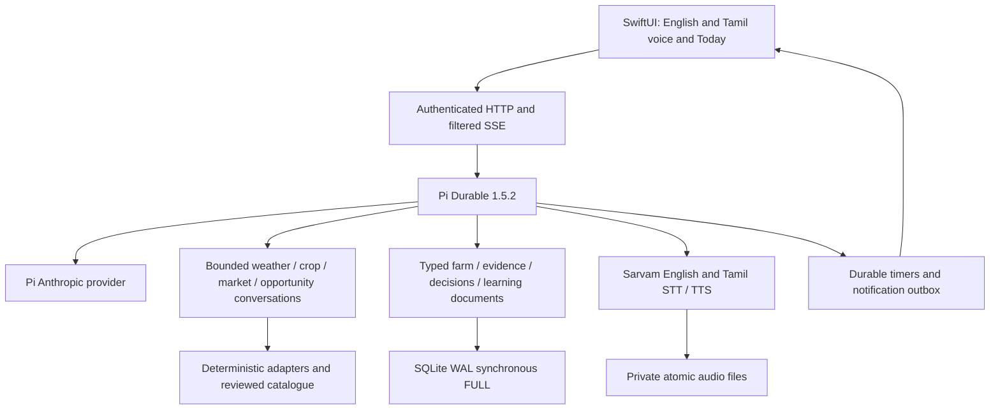

# Kalani: A Farmer's Assistant

Created by [roniejosephv-star](https://github.com/roniejosephv-star).

Native SwiftUI iPhone client for English and Tamil, with one TypeScript Pi Durable backend. Choose a language on first launch or change it under My Farm → Language and audio. Pi owns conversations, checkpointed workflows and authoritative application records. Claude uses Pi's Anthropic provider; speech uses a separate Sarvam adapter. UI styling remains deferred.

Implementation and verification limits are recorded in [IMPLEMENTATION_STATUS.md](IMPLEMENTATION_STATUS.md). Product scope remains in [PRD.md](PRD.md) and [PRODUCT_SPECIFICATIONS.md](PRODUCT_SPECIFICATIONS.md); HTTP interfaces are in [API_CONTRACT.md](API_CONTRACT.md).

## Run locally on your Mac

Requires Node 22.19+ and Xcode with an iPhone Simulator. Verified here with Node26.12.1 and Xcode27.2. The dependency lockfile pins Pi Durable, Pi AI, Chord and Pi Schema to **1.5.2**.

```sh
cd backend
npm ci
cp .env.example .env
```

Put `ANTHROPIC_API_KEY` and `SARVAM_API_KEY` in the local `.env` file. Never paste provider keys into the iPhone app or commit them. `CLAUDE_MODEL` defaults to the installed Pi catalogue's `claude-sonnet-4-5`; actual account access must be checked with your key. Missing keys produce an explicit unavailable-service result, never a fake answer. The bundled app has no canned conversation.

Provision a farmer session while the service is stopped:

```sh
npm run admin -- provision my-demo --output-file .runtime/my-demo-token
pbcopy < .runtime/my-demo-token
npm run build
npm start
```

The local server binds only `127.0.0.1:8787`. Open `ios/FarmAssistant.xcodeproj` from the project root, select `FarmAssistant` and an iPhone Simulator, then Run. Paste the **farmer session token** during the one-time local connection setup. It is stored in Keychain. Provider keys stay on the Mac. For shell builds, Simulator signing must stay enabled:

```sh
xcodebuild -project ios/FarmAssistant.xcodeproj -scheme FarmAssistant \
  -destination 'platform=iOS Simulator,id=683E54CB-6FEC-4788-8B33-E202784DF937' \
  -derivedDataPath ios/DerivedData CODE_SIGNING_ALLOWED=YES CODE_SIGN_IDENTITY=- build
```

The device ID is the verified local iPhone17Pro/iOS26.2; choose another installed device if needed. Unsigned builds compile but cannot use this app's Keychain session. See [ios/README.md](ios/README.md).

A `synthetic-demo` session was provisioned for this implementation's simulator check. Its private token is in `backend/.runtime/demo-token`, excluded from Git. The sample village is explicitly synthetic. It is not an event profile or real farm. `GET /health` reports configuration without exposing secrets.

## Runtime



Only explicitly installed farm extensions run. They offer scoped read tools; no shell, coding tools, file editor, package installer, code mode or arbitrary URL fetch is exposed to the farmer/model. The operator CLI is a separate local host capability.

A farmer owns one main conversation and versioned field/crop-cycle context. Each message durably starts a pipeline: transcription → evidence → bounded relevant specialists → reconciliation → validation/publication → speech. Source fetches run independently; state changes use Pi's single commit line. Speech failure retains text. Message retries preserve logical identity and create a new bounded attempt after an actual failure.

Confirmed corrections invalidate unfinished guidance and pending reminders; completed activities remain dated farmer reports. New location facts without confirmed coordinates clear old coordinates. Main conversation summaries are never authoritative farm facts. Consequential facts are confirmed in the client, and task approvals are recorded only by the authenticated API with the exact version. Postponement requires revised guidance before approval; completion may still be reported independently.

**Published API adjustment:** the npm1.5.2 release has no `defineSignal`/`harness.signal` despite newer main-branch examples. Approvals use a committed decision inbox and durable timer wakeups, normally within30seconds. No model request runs while waiting. Task names remain versioned; retain v1 handlers until unfinished v1 work drains. Do not upgrade the experimental packages without running the recovery suite.

SQLite uses the exported Node adapter with `synchronous=FULL` verified before opening Pi. An empty auxiliary SQLite lease file holds an OS-released exclusive writer lock; it stores no application records and releases after process death. The main Pi database remains the sole source of truth. Never start two writers or copy only a live WAL database file for backup.

Private audio is written, fsynced and atomically renamed before a durable media reference is published. Per-owner operations and deletion checks prevent in-flight speech/upload from recreating deleted media. Interrupted speech/STT may incur another provider call: replay is not a promise of exactly-once billing.

## Sources and delivery

- Open-Meteo: real forecast adapter, explicit requested/grid coordinates, dates, units and modelled provenance. Public snapshots can be reused until their six-hour refresh limit. No private farm facts enter that shared cache. ET0 never becomes an irrigation quantity automatically.
- CEDA: real documented authenticated endpoint. Configure `CEDA_API_KEY` and reviewed commodity/location ID mappings in `FARM_MARKET_MAPPINGS_FILE`. The documented response omits units; unknown units remain explicitly non-comparable. Dated observations are not offers or price forecasts.
- Crop guidance/opportunities: install an operator-reviewed JSON catalogue using `ReviewedRecord` in `backend/src/adapters.ts`. Only current official-source records with named review, matching crop/place/season and validity pass. No KCC corpus or reviewed current scheme catalogue is bundled. Missing access/coverage produces a clarification, not invented advice.
- Sarvam: Tamil and Indian English short-message STT (`saaras:v4`) and TTS (`bulbul:v3`), isolated provider adapters. The client caps recording at29seconds, supports preview/discard, and obtains audio-upload consent. Native comprehension/dialect validation is still required. Server size/type limits do not establish the duration of arbitrary third-party uploads; the speech service can reject unsupported recordings.
- Reminders: persisted intent, exact context/version, opt-in, quiet-hours and expiry checks at wake. Ambiguous dispatch becomes `uncertain`, without automatic resend. Enabled daily updates are durably scheduled for09:00 Asia/Kolkata; the Mac must be awake and the service running. Disabled preferences cancel future delivery. In-app outbox acceptance is not device receipt.
- The native notification test is visibly labelled as a local Simulator test. **Production APNs/WhatsApp delivery is not integrated.** SSE reconnects while the app is active; it is not a background push service.

Forecast freshness and forecast horizon differ: a seven-day weather snapshot refreshes after six hours, so a ready task supported solely by that snapshot cannot outlive its current verification window. Reviewed crop playbooks can support longer calendar items; later weather changes require revalidation.

## Memory, review and recovery

Completion records retain `farmer_reported`, never measured efficacy. They can create private candidate playbooks. Review and each reuse check prerequisites, current evidence and crop context. Improvement proposals arise from corrections, retrieval failures and repeated clarification. A named reviewer and complete labelled farm/Tamil evaluation reports are required for an approved candidate release. Release metadata does **not** modify deployed prompts, tools or agricultural rules. Rollback history is retained.

Stop the service before using the local operator CLI:

```sh
cd backend
npm run admin -- trace my-demo
npm run admin -- metrics my-demo
npm run admin -- propose my-demo
npm run admin -- learning my-demo
npm run admin -- --help
```

The evaluator log contains concise contributions and source IDs, not hidden reasoning. Metrics record bounded latency samples, operation counts/failures and Pi model usage. They do not establish a live service latency/cost target. Errors/retries/interruption details remain available through Pi's task inspection; model attempts and billing should be reconciled with the provider during acceptance.

Back up while the service is stopped:

```sh
cd backend
npm run admin -- backup /absolute/path/to/new-private-backup
```

The command takes the writer lease, creates a consistent SQLite backup, verifies referenced audio hashes and writes a checksum manifest. It excludes plaintext session-token files, provider secrets and external source configuration. Restore only into a new private data directory while stopped: verify the manifest and SQLite integrity, restore database/audio/access hashes, configure `FARM_DATA_DIR`, restore reviewed external inputs separately, and use the same pinned extension versions before resuming. Existing tokens continue to match restored hashes; rotate them if the backup was exposed.

Deletion revokes the account, erases current private projection/audio and aborts owned work. **Pi's immutable transcript history and existing backups are retained.** This is a documented demo limitation, not complete erasure. Before real farmer data, implement and validate a retention/purge policy covering the Pi history, backups and providers. OS permissions protect this local demo; it is not a hardened multi-tenant hosting deployment.

## Verification

```sh
cd backend
npm run build
npm test
```

Tests use explicitly labelled synthetic providers in `test/` only. They exercise real Pi generation/tools/compaction and SQLite, process-kill recovery, one-writer behavior, auth/isolation, duplicate/retry handling, stale approvals, corrections, scheme expiry, uncertain dispatch, playbook review, actual backup/restore and incompatible extension recovery. Loopback HTTP tests need permission to bind a local test socket in a restricted runner.

See [the simulator checklist](IMPLEMENTATION_STATUS.md) for the live voice run and its limits. The five test profiles are synthetic. Actual event profiles and farmer comprehension still require separate validation.
