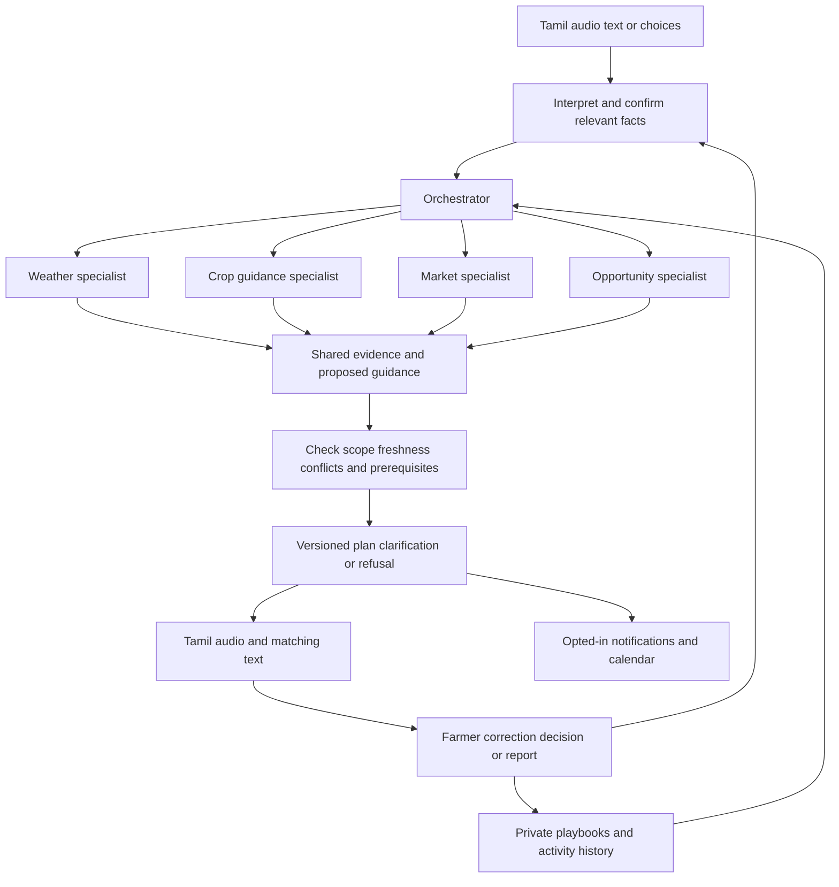
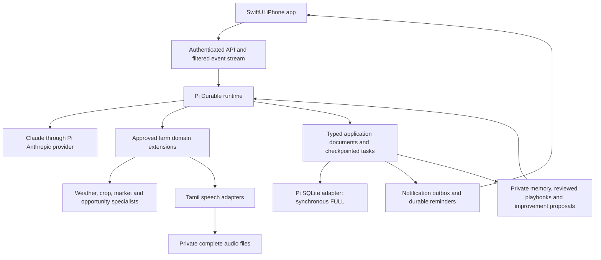

# Multi Agent Farm Operations Orchestrator product specifications

Version 0.5 — 17 November 2026. Status: approved architecture and product specification; implementation verification in progress. Governing product scope: [PRD.md](PRD.md). First demonstration target: native SwiftUI app in iPhone Simulator through Xcode. The authoritative backend is TypeScript with Pi Durable 1.5.2, Pi’s Anthropic provider and SQLite. Production hosting/client rollout and service account access remain open; the final section defines the selected architecture. UI refinement remains deferred.

## 1. Terms and system boundaries

| Term | Meaning |
| --- | --- |
| Farm | A farmer's operational context; may contain multiple fields and crop cycles |
| Crop cycle | One crop/variety in one field during a particular growing period; prevents facts from different seasons being mixed |
| Confirmed fact | Information explicitly confirmed by the farmer or a verified measurement; provenance still identifies its origin |
| Estimate/observation | An approximate, reported, modelled or measured value with time, units and origin; not automatically a confirmed field fact |
| Recommendation | A proposed activity or decision with supporting evidence, applicability and uncertainty |
| Task | A versioned recommendation that can be approved, postponed, completed or superseded |
| Opportunity | An official-source benefit/resource/training candidate whose relevance, availability and eligibility may be partly unknown |
| Playbook/recipe | A private reusable set of contextual practices, explanations and reported outcomes; not an automatically validated treatment formula |
| Agent trace | Inspectable record of specialist contributions, tool/source references, conflicts and the resulting decision; not hidden model chain-of-thought |

Information retrieval, explanation and opted-in delivery do not execute a farming task. Approval in v1 records agreement to that specific proposal; it does not authorise an external purchase, application or device operation.

## 2. Interaction and conversation behaviour

### 2.1 Tamil audio and choices — FR-01, FR-14

- English and Tamil are enabled for the demo. Farmers can switch from the navigation bar or explicitly request a change by voice. Store the preference separately from recognition hints and local vocabulary. Mixed-language speech leaves it unchanged. Kannada, Malayalam, and Telugu are individually gated pilots.
- Provide recording start/stop, preview, discard and explicit send. Microphone access is requested when recording is chosen, not merely when the app opens. Listening requires no microphone permission.
- Every successful assistant response has matching Tamil text and generated audio, replay and relevant contextual choices. Audio generation failure exposes text plus a recoverable audio status; this is degraded service, not full audio success.
- Original recordings, transcripts and extracted facts are separate records. Editing or clarifying an extracted fact does not rewrite the original recording. Retain what was confirmed and from which message.
- One playback at a time; a new playback stops the old one. Replay uses the same saved response. Playing audio must not invoke new reasoning or change the recommendation.
- Choice labels and important numbers/units can be heard. Avoid interactions that require long-press gestures, visual colour interpretation or typing alone. Exact styling and layout remain open.
- If transcription is uncertain or semantically inconsistent, ask a specific clarification with alternatives where available. Do not rely solely on a confidence score or pretend all dialects are understood.
- Recording size/duration limits and handling of long audio must be chosen from provider/device trials. Do not truncate submitted speech silently. Preserve drafts on recoverable interruption and make deletion explicit.

Logical processing states: draft → uploading → transcribing → clarification-needed or reasoning → audio-preparing → ready. Failed processing exposes retry/cancel; a retry retains the same logical message identity and must not produce duplicate tasks or decisions. Text-only/choice input enters the same confirmation/reasoning flow without requiring transcription.

### 2.2 Progressive onboarding — FR-02, FR-03

1. Present Tamil, a listenable welcome and a short explanation of the automated service and audio processing.
2. Ask the immediate concern: weekly work, crop concern or selling. Helpers are optional; do not require helper registration.
3. Collect village/location and crop. Confirm ambiguous place/crop names, preserving the farmer's original Tamil term alongside any normalised identity.
4. Provide the first supported information after these facts are confirmed. A dated market observation or relevant weather fact may be useful before the complete profile exists; a field-specific action still needs its required facts.
5. Ask relevant follow-ups: sowing versus transplanting date, approximate stage, known soil, irrigation/recent water, symptoms, harvest readiness, quantity, reachable markets, storage, transport or labour.
6. Confirm consequential details in short groups. Unknowns remain unknown; “last month” does not become an invented exact day. Ask before interpreting an ambiguous local unit.
7. Explain update preferences after providing value; opting out must not prevent completion. Resume later from confirmed progress.

Do not force soil information before market support, precise GPS before village-level information, or identity/bank documents merely to discover schemes. Authentication remains a stack/design decision, but persistent personal data requires an identity and isolation model before live use.

### 2.3 Return visits, explanations and corrections — FR-03, FR-04

Normal return opens Today with the latest relevant audio, listen/replay and reply. History, weekly activities and editable farm information remain reachable. A notification opens the exact referenced item. These are semantic destinations; their final screen layout/tab structure is not approved.

No new information means an honest empty/update state plus access to the saved plan, not a fabricated fresh advisory. Historical messages retain their dates and any superseded status. Source freshness must not be inferred from the heading “Today.”

“Why?” returns a concise Tamil explanation of the recommendation, evidence, date, applicability and material uncertainty. Sources remain accessible without forcing technical logs on the farmer. Clarification and corrections use the same conversation.

A correction creates a new fact/profile version, identifies dependent recommendations/playbooks, supersedes affected current or future proposals, cancels obsolete queued reminders and requests approval again for changed tasks. Preserve completed activities and their original evidence/version as historical farmer reports; annotate the old recommendation's corrected or inapplicable context separately. Unrelated evidence and tasks remain intact. If the affected dependency cannot be determined reliably, re-evaluate the affected plan before new dispatch rather than assume old advice remains valid.

Draft wording distinguishes “விவரங்கள் சரி” (facts are correct), “செய்ய ஒப்புக்கொள்கிறேன்” (agree to do a task) and “செய்துவிட்டேன்” (reported completed). These examples require native-speaker validation and are not final copy.

## 3. Guidance and cooperating agents

### 3.1 Logical roles — FR-05, FR-06, FR-07, FR-08, FR-12

| Role | Required contribution | Limits |
| --- | --- | --- |
| Farmer conversation | Interpret audio/text/choices, ask clarification, explain results in Tamil | Cannot convert uncertain extraction into confirmed facts or approve a task |
| Weather specialist | Retrieve relevant forecasts/history and describe conditions affecting pending work | Distinguish modelled moisture from field measurements; no irrigation quantity derived from weather alone |
| Crop-guidance specialist | Retrieve applicable crop/stage/local guidance, identify needed observations and help cases | No unsupported diagnosis, invented dose or automatic adoption of historical treatment advice |
| Market specialist | Retrieve commodity/market observations, compare like-for-like data and supplied costs | No guaranteed price, implied buyer offer or unsupported prediction |
| Opportunity specialist | Find official-source candidates, explain scope/conditions and action routes | No false eligibility, invented deadline or application submission |
| Orchestrator | Route relevant work, reconcile contributions with farm constraints, validate evidence and produce a versioned plan | Cannot override missing facts, unsafe conflicts or farmer control to make a complete-looking plan |

Roles are logical responsibilities, not a commitment to separate deployed processes or one model per role. Claude is the intended reasoning candidate; the orchestration framework, service topology and exact models remain open. Speech recognition/synthesis are separate capabilities and need independent evaluation.

### 3.2 Input/output contracts and coordination

A specialist request includes the farm/field/crop-cycle context and versions, farmer concern, relevant confirmed facts/observations, evidence already available and the specific question to resolve. Share only the private information needed for that task.

A specialist result includes role, request/run identity, evidence references, factual findings, candidate recommendations, prerequisites, missing information, material uncertainty/conflicts and a status: supported, needs information, no applicable evidence, unavailable or refused. A tool error is not the same as evidence that no opportunity or agricultural risk exists.

The orchestrator collects relevant independent contributions, checks that each recommendation is supported, reconciles timing/resource conflicts and returns a plan, limited information, clarification or refusal. Conflicts affecting a field action remain visible and unresolved until the needed evidence or expertise exists. Do not silently choose whichever agent produced the most confident prose.

Record which agent contributed what, sources/tool statuses and a concise decision explanation. Do not expose hidden chain-of-thought. Allow export of one plan trace for event evaluation.

Reuse compatible public source snapshots and applicable playbooks; invoke only roles relevant to the question or changed facts. Replaying audio, changing presentation language or reading history must not refetch all sources. Cache validity depends on source/date/scope/version, not simply how recently the cache was written.

### 3.3 Weekly work and farmer decisions — FR-05, FR-13

Create a rolling seven-day plan. Each task records the field/crop cycle, proposed timing, reason, prerequisites, supporting evidence, uncertainty, version and current state. If there is not enough evidence for a task, return a focused question or information item rather than a ready-to-approve instruction.

| Task state | Permitted behaviour |
| --- | --- |
| Needs information | Ask for required facts; cannot approve as an executable proposal |
| Proposed | Farmer may approve, decline, request a change or report that the activity was already done; the last action creates a completion report without retrospective approval |
| Approved | Agreement to this version is recorded; farmer may report completion or request rescheduling |
| Postponed | Record the farmer's intent and agreed replacement time if known; do not infer completion or a new date |
| Completed | Record farmer-reported completion with time; not proof of correct execution or efficacy |
| Declined | Preserve the decision; do not repeatedly reissue unchanged advice |
| Superseded | Retain history, cancel stale reminders and present any replacement as a separate version |

Approval records actor, timestamp, task/version and the explicit action. Delivery, playback, generic fact confirmation and silence cannot create approval. Revalidate a task's applicability when accepting a decision; a farmer cannot accidentally approve an obsolete version. Material date/content changes require explicit confirmation of the new proposal. No automatic external operational action occurs in v1.

An “already done” report may also describe work performed independently of any system proposal. Store it as a farmer-reported activity with its own event time and context, associate it with a task only where applicable, and do not manufacture an earlier approval or claim that the system caused the work.

### 3.4 Market support — FR-07

Match crop/commodity and available variety/grade; clarify unknown or incompatible matches. Preserve market, observation date, aggregation period, min/max/modal definition where supplied, units and source. Missing or unreported prices are not zero. Farmer-confirmed feasible markets govern comparisons; do not assume the highest reported price is the best or reachable option.

Harvest readiness, quantity, storage, transport and other relevant costs support optional scenario comparisons. Calculations must show inputs and assumptions. Subtract only known/supplied costs, label omitted costs and describe the result as an estimate, not guaranteed net profit. Do not equate wholesale observations with farm-gate receipts.

Use dated trends for learning and context. Our own price/yield forecasts are deferred until a later defined target/horizon, time-ordered backtest, simple baseline comparison and error/uncertainty evaluation establish when they can be used. External weather forecasts may be used now with provenance and limitations.

## 4. Farm knowledge, learning and playbooks — FR-09, FR-11

Maintain distinct confirmed facts/preferences, dated observations/actions/outcomes and reusable playbooks. Connect location, field, crop cycle, stage, soil, water, weather, relevant guidance and market constraints through evidence references. A separate graph database is not required by this product model.

Preserve original Tamil terms and normalised identifiers. District-level mapping does not prove a field's soil, actual rainfall or water availability. Crop stage may be estimated from a known event/date and applicable guidance, but consequential stage-dependent actions require suitable confirmation.

Playbook lifecycle: candidate → reusable after source/applicability checks → suspended when prerequisites/evidence no longer hold → retired when replaced or no longer useful. A revised candidate retains its previous versions and may be reviewed again. Farm activities may generate candidates automatically, but an unreviewed candidate is not a validated recipe.

A playbook includes owner/farm/cycle scope, purpose, conditions, source-backed steps, required farmer observations, evidence, reported outcomes, review status and last review. Every reuse refreshes relevant current conditions. Farmer confirmation establishes reported facts/preferences, not agronomic correctness. Professional review requirements remain in force despite a reported positive outcome.

When a farmer reports completion, postponement or an outcome, ask only relevant follow-ups. Do not train a shared model or publish private anecdotes by default. Initial personalisation is better retrieval, confirmed terminology, fewer repeated questions and context-aware reuse.

Offer short optional audio explanations: what changed, why it matters to this crop, what can be checked and what is uncertain. Market learning explains observation dates, units and costs. Seasonal learning uses applicable local contingency/historical guidance; a single weather forecast does not establish climate change. There is no compulsory course or invented yield/profit claim.

## 5. Government opportunities — FR-08

Support relevant benefits, crop insurance, machinery/resource access, training and seasonal support where official sources establish them. Discovery starts with an official index/department/district portal; verify a current operative notification, guideline or application route before describing a candidate as open.

An opportunity record contains official publisher/source, publication and checked dates, applicable season/geography/crop, conditions, verified/unknown farmer matches, availability status, required documents, official next step, and deadline only if verified. Use statuses such as discovered, needs verification, potentially relevant, criteria appear matched, unavailable/expired and not relevant. “Criteria appear matched” is not a government eligibility determination.

Ask only needed screening questions. Explain why the candidate may matter and remaining conditions in Tamil. A budget announcement does not establish an open application window, local allocation or individual entitlement. Official old pages must retain their year; do not create a new “apply now” alert from a successful fetch of old content.

Only a verified date/scope can produce a deadline reminder, after the farmer chooses to save it. With no verified deadline, provide information and an official check-with-office route. Opening a link is not application submission; a farmer-reported application is not official approval. V1 hands off to the official service and does not collect Aadhaar/bank documents merely for discovery.

The initial catalogue may be small and reviewed. It must be honest about geographic/crop coverage. Public developer APIs, automatic status lookups or permission to republish all documents are not assumed.

## 6. Notifications, events and recovery — FR-04, FR-10, FR-14

Use the in-app inbox and calendar as the authoritative saved record. Delivery channel/platform remains open. A successful scheduling/provider response does not establish that the farmer received or heard an update.

The agenda separates confirmed farmer reminders and approved work from drafts and suggested tasks. An exact typed reminder can save with Undo. Spoken requests and interpreted times use a dated preview and explicit Save. Pi validates dates, conflicts, and versions in India time. Calendar entries record farmer intent independently of evidence-backed farm tasks.

Notification inputs include owner, farm/cycle, referenced item/version, relevance reason, category, scheduled local time, expiry, delivery preference and deduplication identity. Support weekly activity reminders, material changed guidance, relevant questions and verified opportunity deadlines. Do not send an unrelated scheme or crop message merely to maintain engagement.

- Explain and obtain update preferences; denied system permission does not disable the app.
- Proposed pilot policy is one digest at the chosen morning/evening time, with quiet hours 20:00–07:00 IST. Exact times/frequency and permitted material-change exceptions require confirmation during implementation planning.
- Before dispatch, check preference, current referenced version, source validity, relevance and prior delivery attempts. Cancel obsolete items. Unchanged source content must not produce a new alert on every refresh.
- Allow disabling updates and changing time/category preferences. No automatic repeated calls or escalating contact after silence.
- Preserve separate scheduled, dispatched, failed, expired and cancelled states. Record receipt/open/play only when corresponding evidence exists; task decisions are independent.
- External calendar integration is deferred. The product requires in-app dated items first; optional export is a later delivery choice.

Recoverable failures preserve submitted work and offer retry without duplicate logical messages, approvals or events. Offline drafts and previously saved accessible content are useful; real-time reasoning and fresh source access must not be promised offline. Expired content can remain in history but cannot masquerade as current guidance.

If a source is unavailable, distinguish the outage from no applicable data. Give supported partial information and a targeted next question; do not invent market observations, source passages or complete crop-health answers. If speech synthesis fails, retain matching text and offer retry; if transcription fails, offer rerecording/choices.

## 7. Data and logical service interfaces

These logical contracts govern the authenticated SwiftUI API. The TypeScript implementation defines concrete routes and wire types; Pi application documents are the canonical state rather than conversation summaries.

| Entity | Required information |
| --- | --- |
| Farmer/preferences | Private owner identity, locale, confirmed vocabulary, contact/update preferences and consent records |
| Farm/field/crop cycle | Ownership, location/scope, crop identity/original term, event dates with precision, stage, soil/water facts, unknowns and versions |
| Observation/activity | Origin, event time, recorded time, field/cycle, value/units, reported/measured/modelled/estimated status and confirmation |
| Message/audio | Author/type, original media reference, transcript, confirmed extractions, response text/audio, locale, processing status, timestamps and stable retry identity |
| Evidence | Publisher, URL/document locator, supporting passage/data, publication/observation/retrieval times, scope, units, validity and access/review state |
| Agent run | Role, input versions, source/tool references/status, structured result, conflicts and decision summary |
| Plan/task/decision | Farm/cycle, version, timing, readiness/prerequisites, evidence, status and explicit actor/time/version decision |
| Playbook | Owner, context/prerequisites, steps, evidence, reported outcomes, lifecycle/review state, versions and last review |
| Opportunity | Official evidence, effective scope/conditions, availability, known/unknown matches, verified deadline and official action route |
| Notification/event | Owner, item/version, relevance/category, schedule/time zone, expiry, deduplication key and independently evidenced delivery/interaction states |

Logical operations:

| Operation | Required contract |
| --- | --- |
| Submit message | Authorised owner/cycle, audio/text/choice, locale and retry identity; return processing state and stable message reference |
| Confirm/correct facts | Expected current version plus explicit confirmations/corrections; return new version and affected guidance |
| Request guidance/explanation | Concern and relevant context/item version; return processing state then evidence-backed information, plan, clarification or refusal |
| Decide/report task | Task/version, explicit decision or reported completion, actor and time; reject stale/conflicting decisions |
| Explain/save opportunity | Opportunity version and requested explanation/reminder; no application side effect |
| Update preferences | Explicit preference changes; cancel incompatible pending dispatch where necessary |
| Export/delete data | Authorised owner request and status; cover messages, recordings, derived private memory and related records under the chosen retention policy |

All operations enforce ownership. Provider credentials remain outside the client. Duplicate requests return the existing logical result or safely resume it. Use version checks for conflicting updates. Mark unsupported input, stale versions, temporary provider failure and no applicable evidence distinctly so the interface can recover correctly.

Do not log raw credentials, private recordings or sensitive government documents in general diagnostics. Exports of event traces must be scoped to the selected farm and redacted for their audience.

## 8. Sources, review and operational controls — FR-06, FR-08, FR-12, FR-13

The entries below describe the 17 November 2026 research snapshot, not successful production integrations. Revalidate current endpoints, content, terms and coverage when integrating.

An anonymous Open-Meteo integration probe on 17 November 2026 successfully returned a seven-day response for sample coordinates 10.79, 79.14, using daily temperature extrema, precipitation sum/probability and reference evapotranspiration with Asia/Kolkata time. Dates ran from 17–23 November 2026 and units were explicitly supplied. Returned grid coordinates were 10.790861, 79.17772; preserve them separately from the requested location. The response's generation-time field measures processing time, not forecast issuance or accuracy. This establishes one endpoint response, not an operational integration, field measurement, validated forecast or farmer recommendation. The restricted-shell DNS attempt failed; the successful probe used an authorised read-only host request.

| Source | Intended use | Known qualification |
| --- | --- | --- |
| [Open-Meteo](https://open-meteo.com/en/docs) | Forecast and available weather variables | Confirm returned location, time zone, units and dates; modelled moisture is not a field sensor |
| [CEDA portal](https://ceda.ashoka.edu.in/data-portal/), [API docs](https://api.ceda.ashoka.edu.in/documentation/) | Prices, arrivals and trends | Portal describes monthly updates; verify series dates. [Terms](https://ceda.ashoka.edu.in/api-terms-conditions/) describe non-commercial use and attribution |
| [KCC](https://kcc-chakshu.icar.gov.in/), [official catalogue](https://data.gov.in/catalog/district-wise-and-month-wise-queries-farmers-kisan-call-centre-kcc) | Archived farmer questions and answers | Direct access failed in research; acquisition, quality and per-record citations remain unresolved |
| [TNAU district advisories](https://agritech.tnau.ac.in/agrometeorologicaladvisory/agro_meteorological_advisory_tnau_district.html), [Tamil archive](https://agritech.tnau.ac.in/ta/agrometeorologicaladvisory/pdf/) | Applicable local agricultural guidance | Current page at research time had a defined forecast period and missing districts; archive dates vary |
| [ICAR-CRIDA contingency plans](https://www.icar-crida.res.in/Crop_Contingency_Plan.html) | Local seasonal and weather-contingency context | Check age, geography and conditions; document presence does not make every practice currently applicable |
| [TN Uzhavar](https://www.tnagrisnet.tn.gov.in/people_app/dashboard/main/en) | Official benefits/resources, contacts, training and other service discovery | Its [scheme list](https://www.tnagrisnet.tn.gov.in/people_app/GoScheme) was labelled 2022–23; verify operative/current availability |
| [PM-KISAN guidelines](https://pmkisan.gov.in/Documents/RevisedPM-KISANOperationalGuidelines%28English%29.pdf), [PMFBY](https://pmfby.gov.in/) | National benefit and insurance candidates | Check current eligibility/notification and applicable state, season, area and crop; no personal status query was tested |
| [IMD rainfall](https://imdpune.gov.in/cmpg/Griddata/Rainfall_25_NetCDF.html), [NASA POWER](https://power.larc.nasa.gov/) | Optional historical context/evaluation | Not prerequisites for first supported conversation; do not substitute history for a forecast |

Source adapters must preserve raw provenance and distinguish valid, historical, expired, unknown-validity, unavailable and no-applicable-data outcomes. Source-specific freshness/refresh thresholds require an integration decision; unknown validity cannot pass as confirmed current evidence. Prefer applicable current official guidance, but retain conflicts and require review where two sources disagree materially.

Content maintenance requires an assigned responsibility for reviewing new/changed schemes and agricultural material; no staff commitment is assumed. At minimum reviewers need to inspect source/version, scope, applicability and supported claims, publish or withhold reviewed records, and withdraw expired content. This does not require a particular admin UI.

Retrieved documents and farmer messages are untrusted inputs to tool policy. They cannot alter approval rules, authorise external actions or reveal another farmer's records. Refuse unsafe chemical-dose requests, unsupported diagnosis and unsupported forecasts; redirect unrelated questions briefly. In uncertain agricultural cases ask for missing observations or offer an appropriate expert route without pretending an expert accepted the case.

Explain audio processing and data use before upload. Do not require consent to model training to use the service. Private storage, cross-user isolation, deletion/export and permission enforcement are required. The earlier blueprint's 30-day original-audio retention is a proposed pilot policy, not a final commitment. Final retention, derived-memory deletion, operational logs/backups and provider obligations must be agreed before live data is collected.

## 9. Acceptance scenarios and handoff

| Scenario | Expected evidence | PRD trace |
| --- | --- | --- |
| Farmer completes Tamil onboarding with audio and choices | Native-speaker-reviewed flow, recording/replay, confirmed village/crop, useful early response and progressive questions | FR-01–FR-03 |
| Microphone denied, upload interrupted or synthesis fails | Recoverable alternative; drafts/confirmed facts survive; no fabricated response or duplicate message/task | FR-01, FR-14 |
| Local crop name is misheard; approximate date is supplied | Specific clarification; precision retained; dependent tasks/reminders invalidated after correction | FR-03, FR-12 |
| Ordinary return and notification entry | Today opens relevant audio/reply; notification targets its exact item; no old content labelled current | FR-04, FR-10 |
| Weather and crop guidance disagree or field observation is missing | Scoped evidence and conflict/missing fact are visible; no unsupported ready-to-approve intervention | FR-05, FR-06, FR-13 |
| One farm has two fields or crop cycles | Facts, observations, tasks and playbooks remain tied to the correct context | FR-05, FR-09, FR-11 |
| Farmer asks why, approves, postpones or says already done before approval | Clear Tamil explanation and distinct versioned actions; independent completion report creates no retrospective approval; corrections preserve completed history | FR-05, FR-12, FR-13 |
| Market prices are old, incomparable or a higher-price market is inaccessible | Original dates/units preserved; unsuitable comparison withheld; costs/limits explained | FR-07 |
| Scheme page is old, deadline absent or eligibility unknown | No false application window/qualification; official next step, verified reminders only | FR-08 |
| Playbook has a reported success but changed conditions | Report stays a report; current applicability checked; suspend rather than reuse unsupported steps | FR-09, FR-11 |
| Retry, disabled notifications, quiet hours or superseded task | No duplicate/stale dispatch; preferences honoured; delivery and farmer decisions separated | FR-10, FR-14 |
| Historical context is used in a seasonal explanation | Applicable source and uncertainty; no unsupported climate, yield or profit claim | FR-11, FR-12 |
| Unsafe/out-of-domain request or malicious retrieved instruction | Understandable refusal/help; no control bypass or private-data disclosure | FR-12–FR-14 |
| Five event profiles are evaluated | Full journeys, architecture, one plan/agent trace and correct refusal record; synthetic fixtures separately labelled | FR-01–FR-14 |

Before a live pilot, collect native-speaker/farmer comprehension evidence, source applicability review, device/audio trials, cross-owner isolation checks and representative latency/cost measurements. The PRD defines proposed pilot sample measures. Passing unit tests or rendering screens cannot replace these checks.

### iPhone Simulator demonstration

The selected demonstration environment is a native SwiftUI app in an iPhone Simulator launched through Xcode. Xcode 27.2 and available iPhone simulators were verified on 17 November 2026. Implementation records must identify the actual selected runtime, build, launch and interaction checks; the earlier planning inventory alone does not establish a working app.

Framework decision: the user selected native SwiftUI for the iPhone demo. See [Apple SwiftUI](https://developer.apple.com/swiftui/). React Native/Expo is not the selected demo client. A later Android client can reuse backend capabilities, but sharing UI code is not an outcome of this decision.

Client/backend boundary: SwiftUI owns presentation, recorder/playback controls, local drafts, permission handling and navigation. Backend interfaces own provider credentials, agent/tool execution, source verification, durable farm/playbook records and scheduled guidance. The client sends an authenticated message or decision and renders the resulting processing state, evidence-linked response and audio. The approved backend uses TypeScript/Pi Durable. Private model and speech keys never enter the app bundle.

Demonstrate the complete agreed product journey in this environment: Tamil onboarding with confirmation/correction, audio messaging/replay, Today guidance, source-linked weekly/market information, an opportunity explanation, a task decision, reported completion and context-checked playbook reuse. Keep unintegrated capabilities explicitly labelled rather than present samples as live inference or notification delivery.

The demonstration record must identify the build/scheme, simulator/runtime, input profiles, real versus fixture-backed sources, speech mode, backend status and notification mode. Credentials must not appear in screenshots, logs or the app bundle. Permission denial, source outage and interrupted processing remain relevant demo cases.

If notifications are injected or locally scheduled for demonstration, label that test mode. Simulator notification interaction does not alone verify production push delivery, background behaviour or real-device permissions. A physical-device phase is required before claims about farmer-phone operation; the farmer pilot's target devices are still undecided.

Production client rollout, account recovery, hosted deployment, real push delivery, retention and operational budgets remain pilot decisions. UI styling remains deferred. The architecture below is approved; its completion is determined by actual implementation verification and the external acceptance gates.

## 10. Authoritative Pi Durable architecture

The approved stack is one native SwiftUI client and one TypeScript backend embedding Pi Durable. The earlier FastAPI/Python SDK/PostgreSQL proposal is retired. Do not add a second independent Claude loop, authoritative database, Redis queue or workflow engine.

### Runtime and storage

Pin `@earendil-works/pi-durable`, `@earendil-works/pi-ai`, `@earendil-works/chord` and `@earendil-works/pi-schema` to the published compatible version **1.5.2**, with the lockfile committed when the project is committed. Treat the runtime as experimental. Use installed package types/exports as the implementation contract; repository `main` documentation may describe newer APIs.

Open SQLite through Pi’s exported adapter, set `PRAGMA synchronous=FULL` before opening the harness, read the setting back, and refuse startup if it is not established. Enforce one writer for a data directory using an OS-released exclusive writer lease. The lease is not an additional application database: farm records remain in Pi storage. SQLite durability does not replace backups or disk-failure recovery.

Maintain one isolated main conversation per farmer and explicit active field/crop-cycle references. Typed application documents contain confirmed facts, immutable-style decisions/history, evidence, message status, task versions, playbooks, media references and notification intent. Commit related domain changes and task creation together. Compacted conversational context cannot override these records. Avoid inheriting approval/outbox state into specialist conversations.

Only approved farm extensions are installed. Farmer conversations receive no coding tools, shell access, filesystem editing, package installation or arbitrary URL retrieval. Pi extensions have host permissions, so runtime allowlists and narrow application adapters are security boundaries owned by this application. Provider credentials stay server-side.

### Workflow and cooperation

Checkpoint the following work: transcription/clarification; deterministic evidence collection; bounded relevant specialist conversations; plan validation/publication; Tamil synthesis; farmer decision waits; and scheduled updates/reminders. Parallelise independent reads and serialize consequential changes. Every specialist returns structured findings with evidence references, applicability, missing facts and uncertainty. The orchestrator reconciles contributions into the source-linked response and plan.

The pinned **1.5.2 package does not export the signal API described on current repository `main`**. The implementation therefore records authenticated task/version decisions in a durable inbox and parks the waiting task on a durable timer, checking at most every 30 seconds. No model request is kept running during this wait. On waking, reread the exact decision and current context/evidence; stale or expired approval cannot authorize changed work. Upgrade to signals only after package/API and restart tests pass.

The model can propose a task but cannot write farmer approval. Confirmations, approvals, rejection, postponement and reported completion are distinct domain operations. Corrections supersede dependent unfinished work and future reminders; completed activities remain dated farmer reports. Conservative invalidation may request fresh planning; it must never silently reuse an old approval.

An external request can complete before its checkpoint is saved. Request deduplication alone therefore does not guarantee exactly-once effects. Persist notification intent before dispatch; assign a stable delivery identity and mark uncertain outcomes for reconciliation instead of blindly retrying. Keep pending work attached to its original versioned task definition during extension upgrades; missing incompatible definitions must fail visibly.

### Source and speech adapters

| Adapter | Implemented integration contract | Remaining acceptance gate |
| --- | --- | --- |
| Open-Meteo | Fixed forecast endpoint, seven daily rows, explicit units/time zone, requested versus grid coordinates, response/date validation and bounded timeout | Field applicability and forecast explanation review; API response is modelled evidence, not a soil sensor |
| CEDA Agmarknet | Documented authenticated `/v1/agmarknet/prices` request with verified source IDs and bounded date interval; preserve observation dates | `CEDA_API_KEY`, real response acceptance and reviewed units. Swagger does not declare price units, so the adapter marks comparisons unsupported until units are supplied from a reviewed source |
| Crop guidance | Locally installed reviewed evidence catalogue with official source, supporting passage, crop/geography/season and validity | Acquire applicable KCC/TNAU/ICAR content and appoint agricultural review; no corpus is fabricated |
| Government opportunities | Same reviewed catalogue mechanism with official sources, current validity and explicit geographic/crop prerequisites | Current operative notifications, deadlines, eligibility scope and official handoff review; no application submission |
| Sarvam STT | Server-side `SARVAM_API_KEY`, `saaras:v4`, Tamil locale, confirmed local vocabulary as recognition hints | Real account/provider trial and native-speaker comprehension evaluation; hints do not confirm extracted facts |
| Sarvam TTS | `bulbul:v3`, Tamil locale, matching text, WAV response validation | Actual pronunciation, latency and device playback; no dialect generation guarantee |

The implemented anonymous Open-Meteo adapter returned valid forecast data in a live check on 17 November 2026. This is one integration probe, not end-to-end agronomic validation. Other authenticated providers remain unverified without credentials. Missing credentials and absent reviewed catalogues are explicit unconfigured states rather than synthetic successes.

Keep each speech recording below 30 seconds for this REST integration and within the upload limit. Individual synthesis requests contain at most 2,500 characters; longer content requires explicit segmentation rather than silent truncation. Generated media must be fully written, synced and atomically renamed before a durable message publishes its private audio reference. Text remains available if speech fails; replay needs no model call.

### Memory and evaluated improvements

Confirmed farmer corrections/preferences/local terms are persistent private memory. Completed activities and outcomes retain `farmer_reported` origin; neither completion nor apparent success proves agricultural efficacy. Candidate playbooks retain source activity, experience IDs, prerequisites, crop/field/cycle, evidence, expiry and version history. A named review can promote a candidate only when prerequisites and evidence currently match. Every reuse rechecks those conditions.

Improvement proposals summarize observed corrections, repeated clarification and retrieval failures. They do not deploy changes. Evaluations require versioned, labelled held-out suites with a recorded outcome for every declared case; a missing result does not pass. Approval requires passing farm and Tamil comprehension suites for the exact proposal version and baseline, plus a named reviewer. Preserve candidate release history and rollback. Activating a candidate in production requires a separately reviewed code/configuration change; approving a record never rewrites live prompts, tools or agricultural rules.

### SwiftUI delivery and operating limits

The authenticated API covers stable-ID message submission, processing state, reconnectable filtered application updates, fact confirmation/correction, exact-version task decisions, preferences, private audio retrieval and owner-scoped export/deletion. Evaluator contributions remain separate from the farmer interface and exclude hidden model reasoning.

The initial notification channel is the in-app inbox/calendar with explicitly labelled native local notification demonstration. APNs provider acceptance, physical-device receipt and listening require separate integration evidence. Server-side timers survive process restarts but cannot deliver while the Mac is asleep or off; recheck expiry and preferences after restart. Do not present local simulator scheduling as production remote push.

Cache only valid public source snapshots across farmers, never private context. Retrieve relevant memory, bypass specialist/model calls for playback and preferences, bound model/tool work, and record usage, latency, retries and relevance before tuning. Extension compatibility, storage backups and operational ownership remain release requirements.

### Verification gates

Automated verification must cover interrupted transcription, specialist work, synthesis and approval waits; repeated submissions; stale approvals; corrections during planning; expiration while reminders sleep; uncertain dispatch; cross-farmer access; compaction independence; and extension upgrades. Integration results and deliberately synthetic fixtures must be clearly distinguished from live-provider success.

A complete event acceptance still requires the five supplied profiles, source-linked plan trace, refusal cases, real Claude and speech credentials, reviewed source content, native Tamil comprehension and representative device/audio checks. Tests and simulator rendering alone do not satisfy these gates. Do not claim the release is complete while any applicable gate remains unverified.

References: [Pi Durable](https://github.com/earendil-works/pi/blob/main/packages/durable/README.md), [Pi Anthropic provider](https://github.com/earendil-works/pi/blob/main/packages/ai/src/providers/anthropic.ts), [Pi SQLite adapter](https://github.com/earendil-works/pi/blob/main/packages/chord/src/sqlite/node.ts), [Pi security guidance](https://docs.pi.dev/latest), [CEDA API schema](https://api.ceda.ashoka.edu.in/documentation/swagger-ui-init.js), [Sarvam STT](https://docs.sarvam.ai/api-reference/speech-to-text/transcribe), [Sarvam TTS](https://docs.sarvam.ai/api-reference/text-to-speech/convert).
